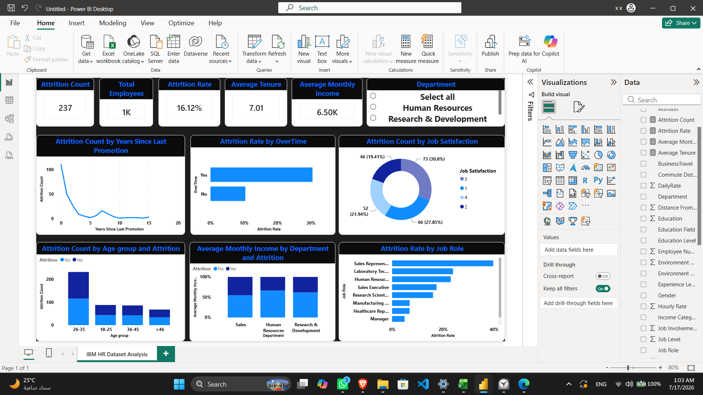

# Midterm Project — IBM HR Employee Attrition Analysis

## Business problem
Why do employees leave, and which groups are most at risk? The goal is to give HR a single interactive view of attrition.

## Dataset
IBM HR Analytics Employee Attrition dataset: 1,470 employees, 35 original columns (41 after feature engineering). Domain: Human Resources.

## Data preparation (Excel / Power Query)
- Checked for duplicates and missing values (none found)
- Converted numeric rating fields (Job Satisfaction, Education, etc.) into readable labels
- Feature engineering: Age Group, Satisfaction Level, Tenure Group, Income Category, Education Level, Experience Level, Prior Experience, Commute Distance
- Removed constant columns (`EmployeeCount`, `Over18`, `StandardHours`)

## Key findings
- Overall attrition rate: **16.12%** (237 of 1,470)
- Overtime workers leave at **30.5%** vs **10.4%** for non-overtime
- Sales (20.6%) and HR (19.0%) have higher attrition than R&D (13.8%)
- Single employees leave at 25.5%, married 12.5%, divorced 10.1%
- Lowest job satisfaction: 22.8% attrition vs 11.3% for the highest
- Attrition is concentrated among recently promoted or short-tenure employees

## KPI
| | |
|---|---|
| KPI | Attrition Rate |
| Target | 15% (commonly cited benchmark for healthy turnover) |
| Result | 16.12% — slightly above target |

## Dashboard (Power BI)
KPI cards (Attrition Count, Total Employees, Attrition Rate, Average Tenure, Average Monthly Income), a Department slicer, and charts for years since last promotion, overtime, job satisfaction, age group, income by department, and job role.

## Recommendations
- Monitor and cap overtime, especially in Sales
- Review promotion cadence
- Run retention initiatives for Sales Representatives and HR staff
- Track the Attrition Rate KPI against 15% regularly

## Tools
Excel, Power Query, Power BI
